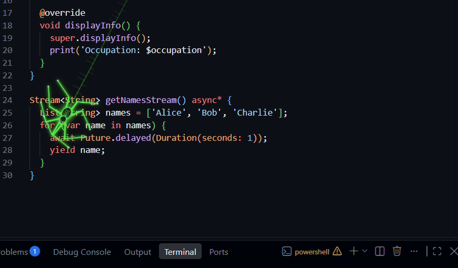

# Cyberpunk Spider 🕷

_A neon, procedurally animated spider that roams your whole VS Code window — over the editor, sidebars and menus. (English summary at the bottom.)_

Une araignée néon, animée procéduralement, qui se promène sur **toute la fenêtre de VS Code** : par-dessus l'éditeur, les barres latérales et les menus.

- **Pattes en cinématique inverse (IK)** : 8 pattes à deux segments, démarche tétrapode. Les pieds restent plantés et font un pas quand le corps s'éloigne.
- **Chasseuse de bugs** : elle erre au hasard, mais file vers les erreurs soulignées en rouge dans l'éditeur et les inspecte.
- **Toile à l'inactivité** : arrêtez de taper, elle rejoint le coin le plus éloigné de votre curseur et tisse sa toile. Retapez : la toile s'estompe.
- **Look néon** : palettes qui s'enchaînent, lueur, petits glitchs, fils de soie éphémères derrière elle.
- **Indifférente à la souris** : elle ne fuit jamais le pointeur et ne capte jamais un clic.
- **Panneau de réglages** : vitesse, taille, néon, délai d'inactivité, palettes, couleurs perso, favoris, on/off rapide.

## Installation par système

### Les 3 étapes (tous systèmes)

1. **Installez l'extension** depuis le Marketplace.
2. Cliquez sur **« Installer maintenant »** dans la notification qui s'affiche (sinon : palette `Ctrl/Cmd+Maj+P` → **Cyberpunk Spider: Installer / réappliquer l'araignée**, ou cliquez sur _« Spider : à installer »_ dans la barre d'état en bas à droite).
3. Cliquez sur **« Recharger la fenêtre »**. L'araignée apparaît.

Si VS Code affiche une erreur de droits, suivez votre système :

### 🪟 Windows

| Votre installation                                                                             | Ce qu'il faut faire                                                                                                                                                     |
| ---------------------------------------------------------------------------------------------- | ----------------------------------------------------------------------------------------------------------------------------------------------------------------------- |
| **« User Installer »** (le plus courant ; dossier `%LOCALAPPDATA%\Programs\Microsoft VS Code`) | Rien de spécial : les 3 étapes suffisent.                                                                                                                               |
| **« System Installer »** (dossier `C:\Program Files\Microsoft VS Code`)                        | Fermez VS Code, faites un **clic droit → Exécuter en tant qu'administrateur**, puis refaites les 3 étapes. Une seule fois. (Ou réinstallez avec l'installeur « User ».) |

Après une mise à jour de VS Code, refaites l'étape 2 (en administrateur pour une installation système).

### macOS

- Si VS Code est dans **/Applications** (cas normal) : les 3 étapes suffisent.
- Si VS Code tourne depuis **Téléchargements** ou depuis l'image disque, macOS l'isole en lecture seule : **déplacez-le dans /Applications**, relancez-le, puis refaites les 3 étapes.
- Si une erreur de droits apparaît, cliquez sur **« Ouvrir un terminal avec sudo »** dans le message : saisissez votre mot de passe dans le terminal, attendez « OK », puis rechargez la fenêtre.
- Après chaque mise à jour de VS Code, refaites l'étape 2.

### Linux

La situation dépend de la façon dont VS Code est installé.

| Installation                                                    | Dossier              | Droits                     | Marche à suivre                                                         |
| --------------------------------------------------------------- | -------------------- | -------------------------- | ----------------------------------------------------------------------- |
| **`.deb` / `.rpm` / dépôt apt-dnf** (le plus courant)           | `/usr/share/code`    | **root requis (une fois)** | Voir ci-dessous                                                         |
| **Archive `.tar.gz`** décompressée dans votre dossier personnel | `~/VSCode-linux-x64` | aucun                      | Les 3 étapes suffisent                                                  |
| **Snap**                                                        | `/snap/code/…`       | ❌ lecture seule           | **Non supporté**. Installez le `.deb` ou l'archive `.tar.gz` à la place |
| **Flatpak**                                                     | `/app/…`             | ❌ lecture seule           | **Non supporté** (idem)                                                 |

**Installation `.deb` / `.rpm` (droits administrateur)**

1. Faites l'étape 2. Le message « _VS Code est installé dans un dossier protégé_ » s'affiche.
2. Cliquez sur **« Ouvrir un terminal avec sudo »**. Un terminal s'ouvre avec la commande déjà prête.
3. **Saisissez votre mot de passe** dans le terminal (rien ne s'affiche pendant la saisie, c'est normal).
4. Quand le terminal affiche **« OK : araignée installée… »**, cliquez sur **« Recharger la fenêtre »**.

> Ce que fait cette commande, en toute transparence : elle écrit les fichiers de l'extension dans le dossier de VS Code, puis **vous donne la propriété** de `workbench.html`, de `product.json` et du dossier du patch. Après ça, réglages, réapplication et désinstallation fonctionnent **sans** sudo. Elle ne touche à rien d'autre.

> Une mise à jour de VS Code par apt/dnf remplace ces fichiers : refaites alors l'étape 2 (un nouveau `sudo` peut être nécessaire).

Vous préférez ne rien automatiser ? Donnez-vous vous-même les droits une fois : `sudo chown -R "$USER" /usr/share/code/resources/app/out /usr/share/code/resources/app/product.json`, puis refaites les 3 étapes.

## Commandes

| Commande                                                        | Effet                                                                |
| --------------------------------------------------------------- | -------------------------------------------------------------------- |
| `Cyberpunk Spider: Installer / réappliquer l'araignée`          | Applique le patch (`cyberpunkSpider.enable`)                         |
| `Cyberpunk Spider: Désinstaller l'araignée (restaurer VS Code)` | Retire le patch et restaure les fichiers (`cyberpunkSpider.disable`) |
| `Cyberpunk Spider: Activer / désactiver rapidement`             | Bascule instantanée, aussi via la barre d'état                       |
| `Cyberpunk Spider: Ouvrir les réglages`                         | Panneau de réglages                                                  |

## Réglages

Tous sous `cyberpunkSpider.*` : `enabled`, `speed`, `size`, `glow`, `idleSeconds`, `palette`, `favoritePalettes`, `huntBugs`, `silkTrail`. Ils s'appliquent en direct ; si l'araignée ne réagit pas au bout de quelques secondes, rechargez la fenêtre.

## Désinstallation propre

**La bonne méthode, dans cet ordre :**

1. Lancez **Cyberpunk Spider: Désinstaller l'araignée (restaurer VS Code)** (sur Linux avec installation système, utilisez « Ouvrir un terminal avec sudo » si on vous le propose).
2. **Rechargez la fenêtre** : l'araignée disparaît et `workbench.html` est restauré à l'identique.
3. Désinstallez ensuite l'extension depuis la vue Extensions.

**Si vous avez désinstallé l'extension directement, sans l'étape 1 :**

- VS Code exécute un nettoyage automatique de l'extension **au prochain redémarrage complet** (quittez VS Code puis relancez-le : _Recharger la fenêtre_ ne suffit pas). Il ne peut réussir que s'il a les droits d'écriture.
- Entre-temps l'araignée **s'arrête d'elle-même** une dizaine de minutes après la disparition de l'extension.
- Si le nettoyage n'a pas pu s'exécuter (Linux, installation système) et que le patch reste dans `workbench.html`, le plus simple est de **réinstaller l'extension, lancer la commande de désinstallation (étapes 1 à 3)**. Autre solution : réinstaller VS Code (`sudo apt install --reinstall code`), ce qui restaure les fichiers d'origine.

## Dépannage

| Symptôme                                              | Cause probable et solution                                                                                                                                                   |
| ----------------------------------------------------- | ---------------------------------------------------------------------------------------------------------------------------------------------------------------------------- |
| L'araignée n'apparaît pas après l'installation        | Avez-vous **rechargé la fenêtre** ? (`Ctrl/Cmd+Maj+P` → _Developer: Reload Window_). Vérifiez que la barre d'état indique « 🐛 Spider » et non « à installer » ou « (off) ». |
| « Droits insuffisants »                               | Voir votre système plus haut (administrateur / sudo).                                                                                                                        |
| L'araignée a disparu après une mise à jour de VS Code | Normal : la mise à jour efface le patch. Acceptez « Réappliquer ».                                                                                                           |
| Alerte « installation corrompue »                     | Cliquez sur _Installer / réappliquer_ (recalcule les checksums). Si elle persiste, lancez _Désinstaller_, rechargez, puis réinstallez.                                       |
| Snap / Flatpak                                        | Non supportés (système de fichiers en lecture seule). Utilisez le `.deb` ou l'archive `.tar.gz`.                                                                             |
| VS Code en SSH / WSL / conteneur                      | L'extension tourne côté interface et patche l'installation **locale** de VS Code.                                                                                            |
| Rien ne se passe                                      | Ouvrez `Developer: Toggle Developer Tools`, onglet Console, et signalez l'erreur sur [GitHub](https://github.com/avatGit/cyberpunk-spider/issues).                           |

## Limites (v0.2)

- La chasse aux bugs réagit aux soulignements d'erreur **actuellement visibles** à l'écran, pas à ceux d'autres fichiers ou hors écran.
- La détection de frappe repose sur les touches de la fenêtre principale.
- Non supporté : VS Code pour le Web, Snap, Flatpak.

## Note

VS Code n'offre aucune API pour dessiner sur toute la fenêtre. L'extension **ajoute un petit bloc `<script>` au fichier `workbench.html` de VS Code** (et copie son moteur à côté).

- Elle **modifie les fichiers de votre installation de VS Code**. Tout est réversible (voir [Désinstallation](#désinstallation-propre)).
- **Installer l'extension ne suffit pas** : il faut ensuite _appliquer_ le patch, puis _recharger la fenêtre_. C'est la raison pour laquelle l'araignée n'apparaît pas tout de suite.
- Une **mise à jour de VS Code efface le patch** : l'extension vous propose de le réappliquer au démarrage suivant.
- L'extension met à jour les `checksums` de `product.json` pour éviter l'alerte « installation corrompue ».
- Elle a besoin des **droits d'écriture** sur le dossier de VS Code (voir votre système ci-dessous).
- Technique non officielle : une future version de VS Code pourrait la casser. Aucune télémétrie, aucun accès réseau.

## Licence

MIT

---

### English summary

Cyberpunk Spider draws a neon, IK-animated spider over the whole VS Code window. VS Code has no API for this, so the extension patches VS Code's `workbench.html` (reversible). After installing the extension you must **run "Install / reapply the spider" and reload the window** (a notification offers it on first run). On Linux system-wide installs (`.deb`/`.rpm`) the extension offers a one-click **sudo terminal** to apply the patch once; Snap and Flatpak are unsupported. To remove it cleanly, run **"Uninstall the spider (restore VS Code)"**, reload, then uninstall the extension.
