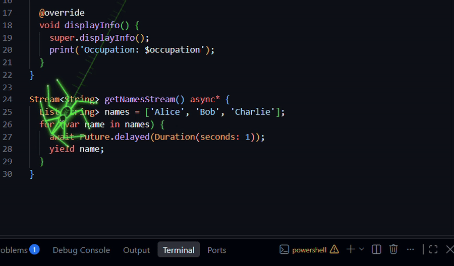

# Cyberpunk Spider

A neon, procedurally animated spider that roams your **whole VS Code window**: over the editor, sidebars and menus.

- **Procedural legs (inverse kinematics)**: 8 two-bone legs with a tetrapod gait. Feet stay planted and step when the body moves away.
- **Bug hunter**: wanders randomly, but walks to visible error squiggles in the editor and inspects them.
- **Idle web weaving**: stop typing and it heads for the corner farthest from your text cursor and weaves a web. Type again and the web fades out.
- **Neon look**: cycling neon palettes with glow and an occasional glitch flicker; leaves short-lived silk threads behind.
- **Ignores your mouse**: it never flees the pointer, and never intercepts a click.
- **Settings panel**: speed, size, glow, idle delay, palettes, custom colors, favorite palettes, quick on/off.

## How it works (read this before installing)

VS Code has no API to draw over the whole window. This extension adds a small `<script>` block to VS Code's own `workbench.html` (and copies its runtime next to it). Consequences:

- It **modifies your VS Code installation files**. Every change is reversible: run **Cyberpunk Spider: Uninstall (restore VS Code)**.
- VS Code **updates overwrite the patch**. The extension re-applies it at next startup and asks you to reload.
- The extension updates `checksums` in VS Code's `product.json` so you do not get the "installation appears to be corrupt" warning. Original values are restored on uninstall.
- It needs **write access** to the VS Code install folder (per-user installs work out of the box; system-wide installs may need a `chown` or admin rights, the extension shows the exact command).
- Not supported: VS Code for the Web, Flatpak/Snap (read-only), remote-only installs.
- This is an unofficial technique. A future VS Code release could break it.
- No telemetry. No network access.

## Getting started

1. Install the extension.
2. Accept the prompt (or run **Cyberpunk Spider: Install / Update**).
3. **Reload the window**.

## Commands

| Command                                                         | What it does                                                  |
| --------------------------------------------------------------- | ------------------------------------------------------------- |
| `Cyberpunk Spider: Installer / réappliquer l'araignée`          | Applies the patch (`cyberpunkSpider.enable`)                  |
| `Cyberpunk Spider: Désinstaller l'araignée (restaurer VS Code)` | Removes it and restores the files (`cyberpunkSpider.disable`) |
| `Cyberpunk Spider: Activer / désactiver rapidement`             | Live toggle, also via the status bar item                     |
| `Cyberpunk Spider: Ouvrir les réglages`                         | Webview with all options                                      |

## Settings

All under `cyberpunkSpider.*`: `enabled`, `speed`, `size`, `glow`, `idleSeconds`, `palette`, `favoritePalettes`, `huntBugs`, `silkTrail`.
Changes apply live; if the spider does not react within a few seconds, reload the window.

## Limitations (v0.1)

- Bug hunting reacts to error squiggles **currently visible** in an editor, not to errors in other files or off-screen.
- Typing detection relies on keystrokes in the main window (not inside webviews or the integrated terminal's own input handling in some builds).

## License

MIT
